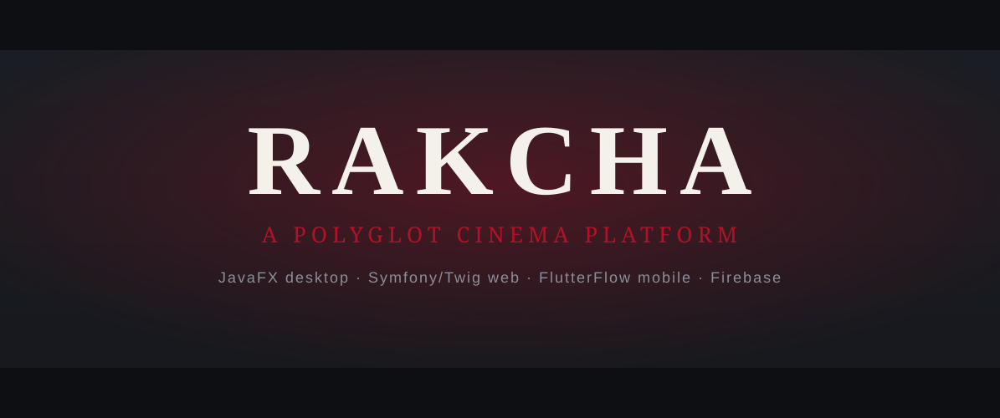
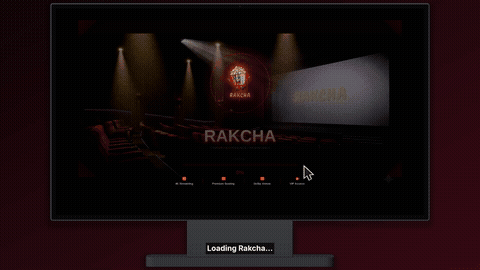
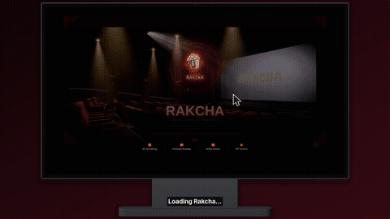
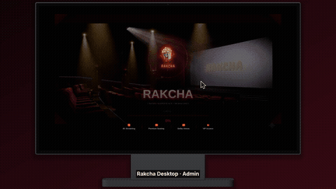
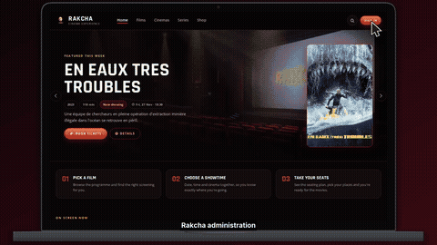
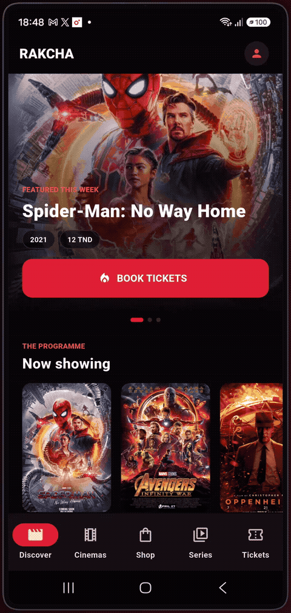
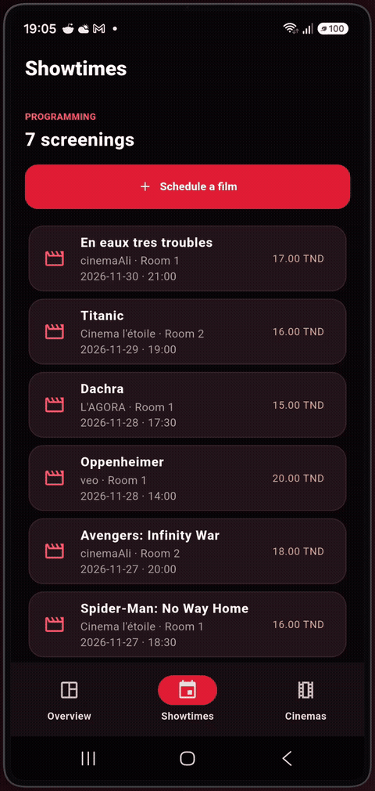
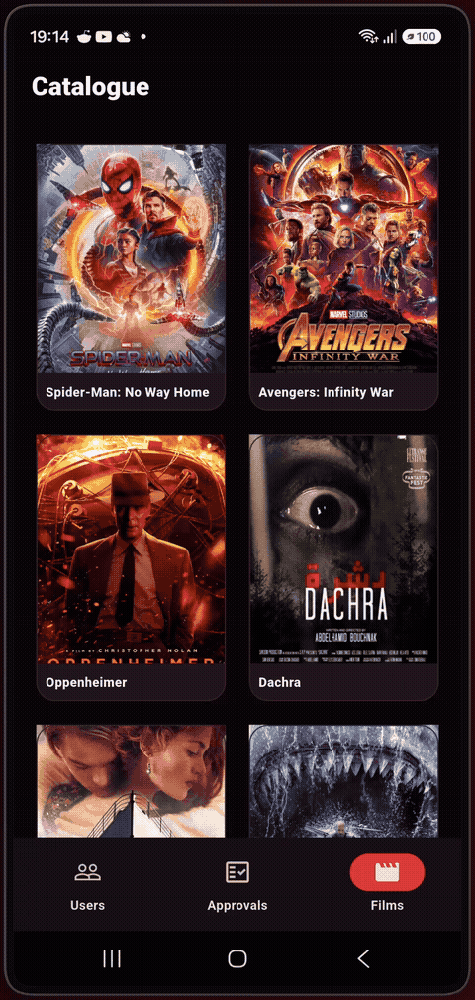

<div align="center">



# 🎬 RAKCHA

### A polyglot cinema platform — built as four independent apps

[](LICENSE)
[](.github/workflows/ci-web.yml)
[](.github/workflows/ci-desktop.yml)
[](.github/workflows/ci-mobile.yml)
[](mkdocs.yml)

</div>

---

## 🎬 Watch RAKCHA — live demos

Every role, on every platform. These clips **play inline right here** — no
external links, no downloads, no mockups. Just the real apps doing real work.

### 🖥️ Desktop · JavaFX 21

| Client | Cinema manager | Admin |
|:---:|:---:|:---:|
| <video src="https://github.com/user-attachments/assets/a607f186-e25d-4a4d-bf88-4795cb54fe5e" poster="assets/demos/desktop-client.gif" controls muted playsinline></video> | <video src="https://github.com/user-attachments/assets/88fee3a7-af5b-4530-aa93-23d5ec6ee79a" poster="assets/demos/desktop-manager.gif" controls muted playsinline></video> | <video src="https://github.com/user-attachments/assets/0f570305-9e7f-4b26-a182-ac73e3cf6a46" poster="assets/demos/desktop-admin.gif" controls muted playsinline></video> |

### 🌐 Web · Symfony / Twig

| Client | Cinema manager | Admin |
|:---:|:---:|:---:|
| <video src="https://github.com/user-attachments/assets/aaf082a6-2004-4c3d-b84b-5bbf6c075e99" poster="assets/demos/web-client.gif" controls muted playsinline></video> | <video src="https://github.com/user-attachments/assets/e226ae6a-0364-4b03-8317-b99a7d165bfa" poster="assets/demos/web-manager.gif" controls muted playsinline></video> | <video src="https://github.com/user-attachments/assets/97283be5-83d1-4755-af2f-c68cebaccb01" poster="assets/demos/web-admin.gif" controls muted playsinline></video> |

### 📱 Mobile · Flutter

| Client | Cinema manager | Admin |
|:---:|:---:|:---:|
| <video src="https://github.com/user-attachments/assets/34028b59-e644-4442-98cb-b16ba7fe98db" poster="assets/demos/mobile-client.gif" controls muted playsinline></video> | <video src="https://github.com/user-attachments/assets/7326e2ab-90c9-4df5-9d6d-cc2ef68172f3" poster="assets/demos/mobile-manager.gif" controls muted playsinline></video> | <video src="https://github.com/user-attachments/assets/ac3c3846-e75f-4234-bb43-31d4f12866df" poster="assets/demos/mobile-admin.gif" controls muted playsinline></video> |

> **What you're seeing:** browse films and series, manage cinemas and showtimes,
> build a shop basket, submit a **seat request** (not a paid ticket), and handle
> cinema approvals as an admin. Each role sees only what it is allowed to see.

---

## What RAKCHA actually is

RAKCHA is a cinema platform — film catalog, cinema/showtime management, online
reservations, and an e-commerce shop — implemented as **four independent
components** that share a problem domain but **not** a codebase or a runtime API:

| Component | Stack | How it reads data |
|---|---|---|
| **Desktop** — `apps/desktop` | JavaFX 21 + Maven | **JDBC directly to the DB** (HikariCP) |
| **Web** — `apps/web` | Symfony 6.4 server-rendered **MVC (Twig)** | Doctrine ORM |
| **Mobile** — `apps/mobile` | **FlutterFlow**-exported Flutter | Firebase / Firestore |
| **Functions** — `apps/mobile/firebase/functions` | Node (LangGraph + Anthropic) | Firebase Admin |

> **The honest architecture.** These are **three independent apps**, not one API
> with many clients. The desktop client talks to the database over JDBC — it does
> **not** call the web app over HTTP. The web app is a classic server-rendered
> Twig site (36 controllers, 71 templates), not an API product. An earlier
> `shared/api-spec/openapi.yaml` stub described routes that no controller served,
> with no client generator wired — it was removed. The only cross-app integration is the
> **AI cinema concierge**, a Firebase callable that the mobile and web apps each
> reach directly over HTTPS.

The interesting story here is the **rare polyglot stack** — running one cinema
domain across a thick JavaFX desktop client, a Symfony/Twig server-rendered web
app, a FlutterFlow mobile app, and Firebase functions — and doing each with the
right tool rather than forcing a single shared API.

---

## Quick start (per app — they're independent)

### Desktop (JavaFX 21)

```bash
cd apps/desktop
mvn clean compile
mvn javafx:run          # launches com.esprit.MainApp
mvn verify              # JUnit5 + TestFX (headless/Monocle) + JaCoCo
```

Native installers (`.msi` / `.dmg` / `.deb`) are built by the jpackage matrix in
`.github/workflows/release-desktop.yml`.

### Web (Symfony / Twig)

```bash
cd apps/web
composer install
cp .env.example .env                       # default DATABASE_URL is SQLite
php bin/console doctrine:migrations:migrate
symfony server:start                       # http://localhost:8000
composer test                              # PHPUnit
composer phpstan                            # PHPStan (+ phpstan-symfony)
```

> No Node build — the dead Symfony Encore/JS was removed; assets are served from
> `apps/web/public/`. Library scripts still load from the jsDelivr npm CDN.

### Mobile (FlutterFlow)

```bash
cd apps/mobile
flutter pub get
flutter run
flutter test --coverage    # scoped to hand-written code (see analysis_options.yaml)
```

### Firebase functions + AI concierge

```bash
cd apps/mobile/firebase/functions
npm install
npm run lint     # ESLint 9 (flat config)
npm test         # Vitest
```

---

## The AI cinema concierge

A film recommender built on the **`@langchain/langgraph` + `@langchain/anthropic`**
deps already in the functions package (model **`claude-haiku-4-5`**). It's a
Firebase **callable** that returns strict JSON recommendations, consumed
**independently** by:

- **Mobile** — `apps/mobile/lib/concierge/concierge_client.dart`
- **Web** — `apps/web/src/Service/ConciergeClient.php` (Symfony HttpClient)

No shared REST API: each app calls the same callable directly. See
[`docs/apps/functions.md`](docs/apps/functions.md).

---

## Project structure

```
rakcha/
├── apps/
│   ├── desktop/    # JavaFX 21 + Maven (JDBC) — README in apps/desktop
│   ├── web/        # Symfony 6.4 + Twig MVC   — README in apps/web
│   └── mobile/     # FlutterFlow Flutter app  — README in apps/mobile
│       └── firebase/functions/  # Node functions + AI concierge
├── docs/           # mkdocs-material site (architecture, per-app, schema)
├── shared/         # schema migration + shared config (no API spec — see decisions)
├── renovate.json   # single dependency bot for all ecosystems
└── mkdocs.yml
```

Per-app READMEs: [desktop](apps/desktop/README.md) ·
[web](apps/web/README.md) · [mobile](apps/mobile/README.md).

---

## Documentation

Built with **mkdocs-material** (`mkdocs build`), deployed to Cloudflare Pages
(gated on secrets). Covers the architecture of the three independent apps,
per-app build/run, the Twig page map, and the database schema — **no API
playground**, because there is no real API.

```bash
pip install -r requirements-docs.txt && mkdocs serve
```

---

## Demos & deployment

Each app ships its own demo — there's no single deploy because they're
independent. The nine inline walkthroughs at [the top of this README](#-watch-rakcha--live-demos)
show every role on desktop, web and mobile. Full steps in
[`docs/deployment.md`](docs/deployment.md).

| Component | How to try it | Hosting |
|---|---|---|
| **Desktop** | Download a native installer (`.msi`/`.dmg`/`.deb`) from [**Releases**](../../releases) | GitHub Releases (jpackage matrix — already wired) |
| **Web** | Symfony app deployable to **Render** (Docker + free Postgres) | Render free tier — `apps/web/Dockerfile` ships ready |
| **Mobile** | `flutter build apk` → Releases / Firebase App Distribution; **TestFlight** for iOS | Firebase |
| **Docs** | This site → **Cloudflare Pages** | CF Pages (the only CF-compatible piece) |

> **Honest hosting note.** Cloudflare Workers run **JS/WASM, not PHP** — so the
> Symfony web app can't live on Cloudflare. After researching the 2026 free-tier
> landscape (Fly.io/Koyeb dropped free compute; Railway is now a 30-day trial),
> the web demo targets **Render** (PHP via Docker + free Postgres); only the
> static docs go to Cloudflare Pages.

---

## Security & supply chain

Polyglot security tooling, one pass across every stack:

| Concern | What's wired |
|---|---|
| **Signed provenance** | **SLSA build provenance** (`actions/attest-build-provenance`) on every jpackage installer — verify with `gh attestation verify <installer> --repo aliammari1/rakcha` |
| **Vuln scanning** | **OSV-Scanner** over `pom.xml` + `composer.lock` + `pubspec.lock` + `package-lock.json` in one pass, plus Trivy fs/config and CodeQL |
| **SBOM** | **CycloneDX** (`cdxgen`) — one aggregated `bom.json` for all four ecosystems |
| **Web CSP** | **NelmioSecurityBundle** Content-Security-Policy + HSTS / nosniff / Referrer-Policy on the Symfony app (host-locked CDN allowlist) |
| **AI anti-abuse** | **Firebase App Check enforced** on the `cinemaConcierge` callable — protects the Anthropic budget |

Actions are SHA-pinned. See [`docs/decisions.md`](docs/decisions.md) for the
rationale and the tracked follow-ups (Symfony 6.4→7.4, PIT/Infection, nonce CSP).

---

## Engineering decisions

A few deliberate choices (full notes in [`docs/decisions.md`](docs/decisions.md)):

- **Independent apps, not one API → many clients.** The "one spec → clients"
  pipeline was never implemented; the apps are treated as the independent
  products they actually are.
- **CodeQL excludes PHP** (no PHP support) — the Symfony app's static gate is
  **PHPStan + phpstan-symfony** with a baseline.
- **One Renovate** at the root replaces a broken Dependabot (`/app/web` typo) +
  two colliding per-app configs.
- **AI as a Firebase callable**, consistent with the independent-apps reality —
  no new shared REST surface to maintain.
- **Cloudflare honesty:** Symfony (PHP) can't run on Workers — only the docs
  site goes to CF Pages; the PHP app needs a PHP host.

---

## License

RAKCHA is licensed under the **RAKCHA Commercial Use License**
(`SPDX-License-Identifier: LicenseRef-RAKCHA-Commercial`). Free for educational
and personal use; commercial use requires a license — see [LICENSE](LICENSE).

Rakcha is an educational project, not a commercial cinema service. The
maintainers do not own third-party film posters, stills, trailers, logos, or
other media shown in the project or its demos. Those assets remain the property
of their respective rights holders and are not covered by the code license.

---

## Branding

The hero/social images are a **TODO** — see [BANNER.md](BANNER.md) for the
finalized cinema-letterbox (2.39:1, theatre-red/charcoal) image-gen prompt.
`assets/banner.svg` is a committed local placeholder so the hero never 404s.
Set the **1280×640** social preview under Settings → Social preview once the
PNG is generated.

## GitHub topics

Suggested repo topics (Settings → Topics) for discoverability:

```
cinema  movies  polyglot  monorepo  javafx  symfony  twig  php
flutter  flutterflow  firebase  langgraph  anthropic  jpackage
maven  doctrine  desktop-app  mkdocs
```

The honest trending hook is the **rare polyglot stack** — one cinema domain
across a JavaFX desktop client, a Symfony/Twig server-rendered web app, a
FlutterFlow mobile app, and Firebase functions — plus the **jpackage native
installers** (the strongest demo magnet here) and the FlutterFlow showcase.
There is intentionally **no "API-first / one-spec-many-clients"** claim — it was
never real. The full discoverability/launch plan lives in [`GROWTH.md`](GROWTH.md).

---

## Related & links

- **Documentation** — mkdocs-material site ([`mkdocs.yml`](mkdocs.yml)) → Cloudflare Pages
- **Per-app READMEs** — [desktop](apps/desktop/README.md) · [web](apps/web/README.md) · [mobile](apps/mobile/README.md)
- **Downloads** — native installers on [Releases](../../releases)
- **Growth/launch kit** — [`GROWTH.md`](GROWTH.md) · **Branding** — [`BANNER.md`](BANNER.md)
- **Contributing** — [`CONTRIBUTING.md`](CONTRIBUTING.md) · **Security** — [`SECURITY.md`](SECURITY.md) · **Conduct** — [`CODE_OF_CONDUCT.md`](CODE_OF_CONDUCT.md)
- **Maintainer** — [@aliammari1](https://github.com/aliammari1)

<div align="center">

**Made with ❤️ for cinema, across four stacks.** · [⭐ Star RAKCHA](../../stargazers)

</div>
